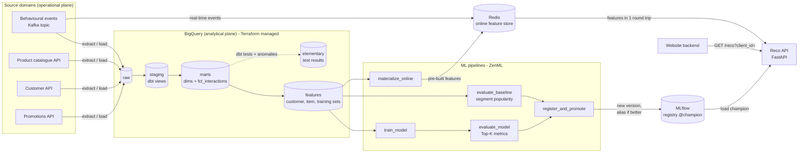

# reco-mlops-lab

An end-to-end recommendation system for a home-improvement (DIY) retailer, built the way a
production team would: infrastructure as code, tested data pipelines, orchestrated ML pipelines
with a model registry and promotion gate, an online feature store and a low-latency API.

| Layer | Tools |
|---|---|
| Infrastructure | Terraform (BigQuery datasets, GCS, service account + IAM) |
| Data pipelines | BigQuery, dbt (tests, model contracts), Elementary (anomaly detection) |
| ML pipelines | ZenML (orchestration, artifacts, lineage), MLflow (tracking, registry, aliases) |
| Model | Item embeddings (truncated SVD on implicit feedback) + segment popularity prior |
| Online features | Redis: batch-materialised features + real-time event stream |
| Serving | FastAPI, Docker |
| Quality | pytest, ruff, GitHub Actions (lint, tests, dbt parse, terraform validate, docker build) |

## Architecture



### Request path (`GET /reco?client_id=C000949&k=10`)
1. One Redis round trip fetches **pre-built features** (segment, recent products from BigQuery) and
   **real-time features** (latest events pushed by the stream consumer).
2. Histories are merged: real-time first, most recent first, deduplicated.
3. The in-memory **champion model** (loaded once from the MLflow registry) builds a user vector from
   the recency-weighted item embeddings and scores the catalogue, blended with the segment's
   popularity prior.
4. Fallbacks for cold start: segment popularity, then global popularity.

Measured locally: **p50 3.5 ms, p95 5.3 ms, p99 15 ms** (200 random customers, k=10).

### Three recommendation levels
| Level | Endpoint | Strategy |
|---|---|---|
| Personalised | `GET /reco?client_id=` | embeddings + segment prior, real-time aware |
| Segment / cold start | (automatic fallback) | segment popularity |
| Category page | `GET /reco/category/{category}` | time-decayed category popularity |
| Product page | `GET /reco/similar/{product_id}` | item-item embedding similarity |

## Offline evaluation

Temporal split: the last 14 days are held out (computed in dbt, so training data is point-in-time
correct). Ground truth is add-to-cart and purchase events in the held-out window. 2,582 customers.

| Model | NDCG@10 | Recall@10 | MAP@10 | Hit rate@10 | Catalogue coverage@10 |
|---|---|---|---|---|---|
| Global popularity | 0.130 | 0.191 | 0.077 | 0.422 | 0.5% |
| Segment popularity (**baseline**) | 0.193 | 0.287 | 0.116 | 0.560 | 1.4% |
| Embeddings only (128 dims) | 0.108 | 0.139 | 0.071 | 0.295 | 84.9% |
| Embeddings + global prior | 0.208 | 0.277 | 0.138 | 0.523 | 23.6% |
| **Embeddings + segment prior (champion)** | **0.221** | **0.290** | **0.148** | **0.541** | **23.6%** |

What the experiments showed:
- The first embedding model **lost to the popularity baseline**. Pure similarity over-diversifies.
  Always measure against a simple baseline before shipping.
- Blending in a popularity prior wins on accuracy **and** shows 17x more of the catalogue than the
  baseline (long-tail exposure matters to the business, not just NDCG).
- Excluding already-seen items hurt every metric: DIY customers re-buy consumables (paint, screws).

## Promotion gate

`register_and_promote` always logs and registers a new MLflow version, but only moves the
`@champion` alias when the candidate beats the baseline by `min_uplift` (2% NDCG) **and** beats the
current champion. The API loads `models:/reco-embeddings@champion`, so promotion and rollback are
just alias moves, followed by `POST /admin/reload`.

```
Model version 1: ndcg=0.2210 baseline=0.1925 champion=0.0000 -> PROMOTED
Model version 2: ndcg=0.1660 baseline=0.1925 champion=0.2210 -> not promoted
```

## Data quality

- **dbt tests**: unique / not_null / relationships / accepted_values / accepted_range, a custom
  `not_in_future` generic test, and a singular test that every purchase follows a view in the same
  session (a data contract with the producing domain).
- **Model contract** on `fct_interactions`: column types and constraints are enforced, because
  training and features depend on that schema.
- **Elementary**: volume and dimension anomaly detection on events (catches an upstream topic that
  silently stops sending, or a sudden shift in the event-type mix). Results land in BigQuery.
- **Source freshness** on raw tables.
- **Pipeline guard**: `validate_training_data` fails the training run before a bad model is built.

## Running it

Prerequisites: `uv`, `dbt-bigquery`, `terraform`, `docker`, `gcloud auth application-default login`.

```bash
cp .env.example .env            # set GCP_PROJECT
make infra                      # Terraform: datasets, bucket, service account
make data load                  # generate synthetic data, land it in BigQuery raw
make dbt-build                  # staging -> marts -> features, all tests + Elementary
make services                   # Redis on :6380
make mlflow                     # MLflow on :5001 (separate terminal)
make train materialize          # ZenML pipelines
make serve                      # API on :8010
curl "localhost:8010/reco?client_id=C000949&k=5"
curl -X POST localhost:8010/events -H 'content-type: application/json' \
     -d '{"client_id":"NEW1","product_id":"P00601"}'
```

`uv run zenml login --local` opens the ZenML dashboard (runs, step metadata, artifact lineage);
the MLflow UI is at `http://127.0.0.1:5001`.

## Repository layout

```
infra/terraform/        GCP resources (datasets, bucket, IAM)
dbt/                    staging, marts, features + tests, contract, Elementary
src/reco/data/          synthetic data generator, BigQuery loader/reader
src/reco/models/        recommender, MLflow pyfunc packaging
src/reco/evaluation/    Top-K metrics (precision, recall, NDCG, MAP, hit rate, coverage)
src/reco/pipelines/     ZenML steps, pipelines, custom materializer
src/reco/feature_store/ Redis online store (batch + real-time)
src/reco/serving/       FastAPI app
tests/                  unit + API tests (fakeredis, no cloud needed)
```

## Path to production

| Here | Production on GCP |
|---|---|
| ZenML local orchestrator | ZenML stack: Kubernetes / Vertex orchestrator, GCS artifact store, scheduled runs (or Argo Workflows) |
| MLflow on SQLite | MLflow on Cloud Run or GKE with Cloud SQL backend + GCS artifacts |
| `/events` endpoint | Kafka consumer (or Dataflow) updating real-time features; at-least-once handled by idempotent keys |
| Redis container | Memorystore, or a managed feature store (Feast / Vertex AI Feature Store) |
| Brute-force scoring (2k items) | ANN retrieval (ScaNN / Vertex Vector Search) then a ranking model, for a catalogue of 100k+ items |
| Offline metrics | A/B test on CTR / add-to-cart / revenue per session; offline metrics only gate candidates |
| Logs | Datadog / Grafana: latency SLOs, fallback rate, feature freshness, score distribution drift |
| Manual promotion trigger | CI/CD: model validation then canary rollout of the new alias, auto rollback on SLO breach |

Next model iterations: two-tower retrieval with content features (category, brand, price) for
cold-start items, a ranking stage (GBDT / LightGBM with context features: promotions, seasonality,
store stock), and session-based sequence models for in-session intent.
