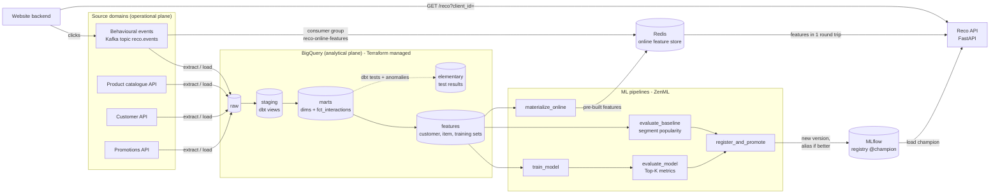

# reco-mlops-lab

An end-to-end recommendation system for a home-improvement (DIY) retailer, built the way a
production team would: infrastructure as code, tested data pipelines, orchestrated ML pipelines
with a model registry and promotion gate, an online feature store and a low-latency API.

**Data: real, public behavioural data.** One month (November 2019, incl. Black Friday) of the
[REES46 multi-category store dataset](https://www.kaggle.com/datasets/mkechinov/ecommerce-behavior-data-from-multi-category-store),
67.5M events streamed and filtered to the departments a DIY retailer sells (tools, kitchen,
plumbing & bathroom, heating & climate, storage & lighting, garden):
**3.6M events, 405k customers, 16.8k products**.

| Layer | Tools |
|---|---|
| Infrastructure | Terraform (BigQuery datasets, GCS, service account + IAM) |
| Data pipelines | BigQuery, dbt (tests, model contracts), Elementary (anomaly detection) |
| ML pipelines | ZenML (orchestration, artifacts, lineage), MLflow (tracking, registry, aliases) |
| Model | Item embeddings (truncated SVD on implicit feedback) + segment prior + recency boost on seen items |
| Event stream | Redpanda (Kafka API): `reco.events` topic keyed by customer, consumer group, dead-letter topic |
| Online features | Redis: batch-materialised features + real-time features from the Kafka consumer |
| Serving | FastAPI Reco API, demo storefront (website + backend), Docker |
| Quality | pytest, ruff, GitHub Actions (lint, tests, dbt parse, terraform validate, docker build) |

## Architecture



### Request path (`GET /reco?client_id=U343318208&k=10`)
1. One Redis round trip fetches **pre-built features** (segment, recent products from BigQuery) and
   **real-time features** (latest clicks, applied by the Kafka consumer within milliseconds).
2. Histories are merged: real-time first, most recent first, deduplicated.
3. The in-memory **champion model** (loaded once from the MLflow registry) builds a user vector from
   the recency-weighted item embeddings, scores the 16.6k active products, adds the segment's
   popularity prior and boosts the customer's own recent products (re-engagement).
4. Fallbacks for cold start: segment popularity, then global popularity.

Measured locally: **p50 10 ms, p95 16 ms, p99 21 ms** (300 random customers, k=10, brute-force scoring of 16.6k products).

### Three recommendation levels
| Level | Endpoint | Strategy |
|---|---|---|
| Personalised | `GET /reco?client_id=` | embeddings + segment prior, real-time aware |
| Segment / cold start | (automatic fallback) | segment popularity |
| Category page | `GET /reco/category/{category}` | time-decayed category popularity |
| Product page | `GET /reco/similar/{product_id}` | item-item embedding similarity |

## Offline evaluation

Temporal split: the last 14 days (17-30 Nov, incl. Black Friday) are held out, computed in dbt so
training data and customer segments are point-in-time correct. Ground truth is add-to-cart and
purchase events in the held-out window. **9,774 evaluation customers**, 16,590 active products.
Reproduce with `uv run python notebooks/compare_models.py`.

| Model | NDCG@10 | Recall@10 | MAP@10 | Hit rate@10 | Coverage@10 |
|---|---|---|---|---|---|
| Global popularity | 0.036 | 0.074 | 0.022 | 0.089 | 0.1% |
| Segment popularity | 0.074 | 0.127 | 0.054 | 0.151 | 0.4% |
| **Recently viewed + segment fill (baseline)** | 0.307 | 0.413 | 0.262 | 0.466 | 49% |
| Embeddings only | 0.147 | 0.216 | 0.120 | 0.248 | 63% |
| Embeddings + segment prior (v4) | 0.223 | 0.332 | 0.180 | 0.375 | 16% |
| Embeddings, excluding seen products | 0.051 | 0.083 | 0.037 | 0.109 | 18% |
| **Embeddings + segment prior + seen boost (champion v5)** | **0.320** | **0.437** | **0.271** | **0.488** | **47%** |

What the experiments showed:
- **A naive baseline hides the real bar.** The first real-data model beat segment popularity 3x
  and was promoted, but a "recently viewed" heuristic beat *it* (0.307 vs 0.223): 77% of the
  model's hits were products the customer had already seen. The gate now uses that heuristic.
- **Real shoppers come back to what they viewed** (comparison shopping before buying a drill or
  an oven). Excluding seen products collapses NDCG to 0.051, so discovery alone is hard.
- The champion combines both behaviours: it re-ranks recent products first and fills the list
  with embedding recommendations. +4% NDCG and +6% recall over the strong baseline, with more
  hits on products the customer had not seen.
- 128 dimensions perform like 256 once the boost is on, so the smaller model was kept.

## Promotion gate

`register_and_promote` always logs and registers a new MLflow version, but only moves the
`@champion` alias when the candidate beats the baseline by `min_uplift` (2% NDCG) **and** beats the
current champion. The API loads `models:/reco-embeddings@champion`, so promotion and rollback are
just alias moves, followed by `POST /admin/reload`.

```
Model version 4: ndcg=0.2235 baseline=0.0744 champion=0.0000 -> PROMOTED   (baseline: segment popularity)
Model version 5: ndcg=0.3199 baseline=0.3074 champion=0.2235 -> PROMOTED   (baseline: recently viewed)
```
Versions 1-3 were trained on an earlier synthetic dataset. Every run and version is tagged with
`data_source`, and the old champion alias was retired when the data changed, because NDCG
measured on a different evaluation set is not comparable.

## Data quality

- **dbt tests**: unique / not_null / relationships / accepted_values / accepted_range and a custom
  `not_in_future` generic test. On the real data they caught **216 products with a price of 0**
  (now inactive, never recommended) and **3,802 duplicate events** (removed in staging).
- **Data contract** (singular test): a purchase must follow a view or add-to-cart of the product.
  The first version required the same session and failed on 431 purchases (1.4%): 313 were
  viewed in an *earlier* session, only 118 (0.4%) had no trace. The rule now accepts earlier
  sessions and fails above a 1% violation rate.
- **Model contract** on `fct_interactions`: column types and constraints are enforced, because
  training and features depend on that schema.
- **Elementary**: volume and dimension anomaly detection on events (catches an upstream topic that
  silently stops sending, or a sudden shift in the event-type mix). Results land in BigQuery.
- **Source freshness** on raw tables.
- **Pipeline guard**: `validate_training_data` fails the training run before a bad model is built.

## Running it

Prerequisites: `uv`, `dbt-bigquery`, `terraform`, `docker`, `gcloud auth application-default login`.

```bash
cp .env.example .env            # set GCP_PROJECT
make infra                      # Terraform: datasets, bucket, service account
# download 2019-Nov.csv.zip from the Kaggle link above into data/source/
make data load                  # filter + reshape the public month, land it in BigQuery raw
make dbt-build                  # staging -> marts -> features, all tests + Elementary
make services                   # Redis on :6380
make mlflow                     # MLflow on :5001 (separate terminal)
make train materialize          # ZenML pipelines
make kafka                      # Redpanda on :19092, console on http://localhost:8090
make serve                      # Reco API on :8010           (separate terminal)
make consumer                   # reco.events -> Redis          (separate terminal)
make website                    # demo store on :8020          (separate terminal)
curl "localhost:8010/reco?client_id=U343318208&k=5"
```

Open `http://127.0.0.1:8020`, pick a shopper or "New visitor" and open products: each click is
published to Kafka, the consumer updates Redis, and the next page is personalised.

## Real-time event stream

```
website backend --produce (key = client_id)--> reco.events (3 partitions)
     --> consumer group reco-online-features --> Redis fs:recent:{client_id}
     \-> malformed messages --> reco.events.dlq
```

- **Ordering**: the key is the customer id, so one customer's clicks stay in one partition, in order.
- **At-least-once**: auto-commit is off; the offset is committed after Redis is updated, so a crash
  replays messages instead of losing them. The producer uses `acks=all` and idempotence.
- **Idempotency**: each event carries an `event_id`; the consumer keeps a 24 h marker per id and
  skips redeliveries (rewinding the group to the start re-applied nothing).
- **Bad data**: messages that fail the `ClickEvent` contract go to the dead-letter topic and the
  consumer keeps running. (A replay re-sends them to the DLQ, so DLQ readers should de-duplicate.)
- **Outage test**: with the consumer stopped, three clicks raised the group lag to 3 and the
  visitor still got best sellers; on restart it resumed from the committed offset, applied the
  three clicks in order and the visitor was personalised, lag back to 0.

`uv run zenml login --local` opens the ZenML dashboard (runs, step metadata, artifact lineage);
the MLflow UI is at `http://127.0.0.1:5001`.

## Repository layout

```
infra/terraform/        GCP resources (datasets, bucket, IAM)
dbt/                    staging, marts, features + tests, contract, Elementary
src/reco/data/          REES46 preparation, BigQuery loader/reader (+ synthetic generator for tests)
notebooks/              offline comparison of baselines and model variants
src/reco/models/        recommender, MLflow pyfunc packaging
src/reco/evaluation/    Top-K metrics (precision, recall, NDCG, MAP, hit rate, coverage)
src/reco/pipelines/     ZenML steps, pipelines, custom materializer
src/reco/feature_store/ Redis online store (batch + real-time)
src/reco/serving/       FastAPI Reco API
src/reco/streaming/     Kafka event contract, producer, consumer (+ DLQ)
src/reco/website/       demo storefront (backend + page)
tests/                  unit + API tests (fakeredis, no cloud needed)
```

## Path to production

| Here | Production on GCP |
|---|---|
| ZenML local orchestrator | ZenML stack: Kubernetes / Vertex orchestrator, GCS artifact store, scheduled runs (or Argo Workflows) |
| MLflow on SQLite | MLflow on Cloud Run or GKE with Cloud SQL backend + GCS artifacts |
| Single Redpanda node, 3 partitions | Managed Kafka (3 brokers, replication 3), more partitions and consumer replicas; a second consumer group landing events in BigQuery for the next training run |
| Redis container | Memorystore, or a managed feature store (Feast / Vertex AI Feature Store) |
| Brute-force scoring (16.6k items) | ANN retrieval (ScaNN / Vertex Vector Search) then a ranking model, for a catalogue of 100k+ items |
| Offline metrics | A/B test on CTR / add-to-cart / revenue per session; offline metrics only gate candidates |
| Logs | Datadog / Grafana: latency SLOs, fallback rate, feature freshness, score distribution drift |
| Manual promotion trigger | CI/CD: model validation then canary rollout of the new alias, auto rollback on SLO breach |

Lessons from running it:
- **Retention rules can delete data silently.** A 400-day partition expiry on `raw` dropped every
  2019 partition on load (0 rows, no error). Removed in Terraform; retention is now per table.
- **A pickled model depends on the serving code.** After a scoring change, `POST /admin/reload`
  loaded v5 into an API still running the old code, so the new boost was ignored. Model and code
  must ship together (one Docker image per release, with the model version pinned in it).

Next model iterations: two-tower retrieval with content features (category, brand, price) for
cold-start items, a ranking stage (GBDT / LightGBM with context features: promotions, seasonality,
store stock), and session-based sequence models for in-session intent.
